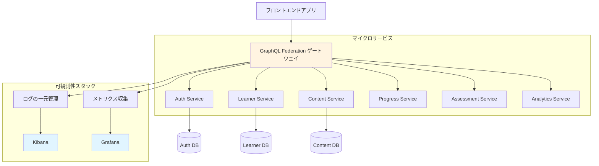

## 概要

upGrad Education にて、20以上のマイクロサービスの API を一つにまとめる GraphQL Federation ゲートウェイを構築しました。統一された API レイヤーに加えて、Kibana と Grafana によるログとモニタリングの一元化を進めたことで、障害の検知と原因分析が速くなり、本番障害を60%削減しました。

**使用技術:** GraphQL Federation, Node.js, TypeScript, Kibana, Grafana, マイクロサービス

**役割:** Software Engineer II ｜ **期間:** 2024年7月〜2026年2月

## 課題

プラットフォームは成長に合わせて20以上のマイクロサービスへと広がり、それぞれが独自の REST API を公開していました。

- **API の分散:** フロントエンドチームは、複数のサービスのエンドポイントと個別に連携する必要があった
- **原因特定の遅さ:** 障害が起きたとき、どのサービスが原因かを突き止めるのに時間がかかっていた
- **一元的な可視性の欠如:** ログとメトリクスが各サービスに散らばっていた
- **エラー処理の不統一:** サービスごとにエラーの形式や規約が異なっていた

このようにアーキテクチャが分断されていたため、次のことが困難でした。

- 本番障害の迅速なデバッグ
- サービスをまたぐリクエストの流れの把握
- 認証とエラー処理の一貫した実装
- システム全体の健全性の監視

## ソリューションのアーキテクチャ

### GraphQL Federation ゲートウェイ

複数のサービスのグラフを一つの API に合成するゲートウェイ層を構築しました。



### ゲートウェイの実装

ゲートウェイは唯一の入口として、各サービスへのクエリをフェデレーションしました。

```typescript
// Gateway server setup
import { ApolloGateway, IntrospectAndCompose } from '@apollo/gateway';
import { ApolloServer } from '@apollo/server';

const gateway = new ApolloGateway({
  supergraphSdl: new IntrospectAndCompose({
    subgraphs: [
      { name: 'auth', url: 'http://auth-service/graphql' },
      { name: 'learner', url: 'http://learner-service/graphql' },
      { name: 'content', url: 'http://content-service/graphql' },
      { name: 'progress', url: 'http://progress-service/graphql' },
      // ... 20+ services total
    ],
  }),
});

const server = new ApolloServer({
  gateway,
  plugins: [
    // Request logging and tracing
    loggingPlugin(),
    metricsPlugin(),
  ],
});
```

### サブグラフのスキーマ例

各サービスは、自身のドメインを GraphQL のサブグラフとして公開しました。

```graphql
# Learner service subgraph
extend schema @link(url: "https://specs.apollo.dev/federation/v2.0")

type Learner @key(fields: "id") {
  id: ID!
  name: String!
  email: String!
  enrollments: [Enrollment!]!
}

type Enrollment @key(fields: "id") {
  id: ID!
  learnerId: ID!
  courseId: ID!
  enrolledAt: String!
  status: EnrollmentStatus!
}
```

## 可観測性の実装

### Kibana によるログの一元管理

ゲートウェイを通るすべてのリクエストを、構造化されたコンテキスト付きで記録しました。

```typescript
// Logging plugin
function loggingPlugin() {
  return {
    async requestDidStart(requestContext) {
      const requestId = generateRequestId();
      const startTime = Date.now();

      return {
        async willSendResponse(responseContext) {
          const duration = Date.now() - startTime;

          logger.info('GraphQL Request', {
            requestId,
            operation: requestContext.request.operationName,
            duration,
            success: !responseContext.errors,
            userId: responseContext.contextValue.userId,
            errors: responseContext.errors?.map((e) => e.message),
          });
        },
      };
    },
  };
}
```

### Grafana によるメトリクス

運用上の主要なメトリクスを追跡しました。

- オペレーションごとのリクエスト数
- サブグラフごとのエラー率
- リクエストの所要時間（p50、p95、p99）
- アクティブユーザー数とセッションのデータ

```typescript
// Metrics collection
function metricsPlugin() {
  return {
    async requestDidStart(requestContext) {
      metrics.increment('graphql.request.total');

      return {
        async willSendResponse(responseContext) {
          const operation = requestContext.request.operationName;

          if (responseContext.errors) {
            metrics.increment(`graphql.error.${operation}`);
          } else {
            metrics.increment(`graphql.success.${operation}`);
          }
        },
      };
    },
  };
}
```

## 主なメリット

### 1. クライアントにとって統一された API

**導入前:** フロントエンドは複数のサービスのエンドポイントを個別に呼び出していました。

```typescript
// Multiple API calls
const user = await fetch('/auth-service/user');
const enrollments = await fetch('/learner-service/enrollments');
const progress = await fetch('/progress-service/progress');
```

**導入後:** 一つの GraphQL クエリで完結します。

```graphql
query GetLearnerDashboard($userId: ID!) {
  learner(id: $userId) {
    name
    email
    enrollments {
      course {
        title
      }
      progress {
        completionPercentage
      }
    }
  }
}
```

### 2. 障害対応の迅速化

**Kibana に一元化したログ** は、次の条件で絞り込めるようになりました。

- リクエスト ID（サービスをまたいでリクエストを追跡）
- オペレーション名
- エラーの種類
- ユーザー ID
- 期間

**Grafana のダッシュボード** では、次のことが一目でわかるようになりました。

- どのオペレーションが失敗しているか
- どのサブグラフのエラー率が上がっているか
- リクエスト所要時間の推移

### 3. 一貫したエラー処理

ゲートウェイで、すべてのサービスのエラー形式を統一しました。

```typescript
// Error formatting
function formatError(error: GraphQLError) {
  return {
    message: error.message,
    code: error.extensions?.code || 'INTERNAL_SERVER_ERROR',
    path: error.path,
    // Never expose internal stack traces
  };
}
```

## 課題と解決策

### 課題1: スキーマ変更の調整

**問題:** 20以上のサービスにまたがるスキーマ変更を、足並みをそろえて進める必要がありました。

**解決策:**

- CI/CD でのスキーマ検証により、破壊的変更を防止
- 非推奨の警告付きでスキーマをバージョン管理
- チームをまたぐスキーマ更新のための、明確なコミュニケーション経路

### 課題2: ゲートウェイが単一障害点になる

**問題:** ゲートウェイが停止すると、すべての API にアクセスできなくなります。

**解決策:**

- ロードバランサー配下に複数のゲートウェイインスタンスを配置
- ヘルスチェックと自動フェイルオーバー
- ゲートウェイとサブグラフを独立してデプロイ

### 課題3: パフォーマンスのオーバーヘッド

**問題:** ゲートウェイを経由する分、レイテンシーが増える可能性がありました。

**解決策:**

- DataLoader のバッチ処理で、サブグラフへの N+1 クエリを防止
- 頻繁にアクセスされるデータのレスポンスをキャッシュ
- p95／p99 のレイテンシーを監視し、オーバーヘッドが許容範囲に収まっていることを確認

## 成果

- **本番障害を60%削減:** 検知と原因特定の迅速化による
- **統一された API:** 20以上のマイクロサービスとのフロントエンド連携をシンプルに
- **可観測性の一元化:** Kibana と Grafana で、根本原因を素早く分析
- **一貫したエラー処理:** デバッグのしやすさとユーザー体験を改善

### 効果の測定方法

60%の削減は、次のように算出しました。

- **導入前:** それ以前の四半期に記録していた障害件数
- **導入後:** ゲートウェイとモニタリングの導入後に減少した障害件数
- **要因:** 統一 API とログの一元化の両方が寄与しているため、二つを合わせた成果として正直に示しています

## 学んだこと

### Federation のアーキテクチャ

- 多数のサービスのグラフをゲートウェイで合成する（BFF ではなく Federation パターン）
- ゲートウェイは薄く保ち、ビジネスロジックはサブグラフに置く
- スキーマの調整には、技術だけでなくプロセスが必要

### 可観測性

- 分散システムでは、ログの一元管理が欠かせない
- サービスをまたぐリクエスト ID の追跡が、デバッグを可能にする
- ダッシュボードは、誰かが見ていてこそ役に立つ

### あえてやらなかったこと

- 根拠のない Exactly-Once 配信をうたわない
- 独自のスキーマレジストリは作らない（Apollo の組み込みのコンポジションを使用）
- 60%の削減をゲートウェイだけの成果とはしない（モニタリングも同じくらい重要だった）

## インパクト

可観測性を一元化した GraphQL Federation ゲートウェイによって、チームの仕事の進め方が変わりました。

- **開発:** フロントエンドチームは、20以上ではなく一つの API と連携すればよくなった
- **デバッグ:** 根本原因の特定にかかる時間が、数時間から数分に短縮された
- **監視:** 一つのダッシュボードで、全サービスの健全性を確認できるようになった
- **リリース:** スキーマ検証のもとで、サブグラフを独立して進化させられるようになった

このアーキテクチャは upGrad におけるクライアント向け API 全体の基盤となり、よく考えられた API 設計と確かな可観測性の実践を組み合わせることで、運用面で測定可能な改善が得られることを示しました。
