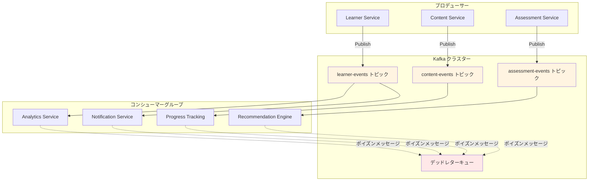

## 概要

upGrad Education にて、21以上のマイクロサービスにまたがり1日10万件以上のイベントを処理する Kafka のプロデューサー／コンシューマーの設計パターンを担当しました。学習者のライフサイクルやコンテンツに関するイベントを扱い、トラフィックの急増や部分的な障害が発生しても、下流のサービスが整合性を保てるようにしています。

**使用技術:** Apache Kafka, Node.js, TypeScript, マイクロサービス

**役割:** Software Engineer II ｜ **期間:** 2024年7月〜2026年2月

## 課題

学習者のライフサイクルやコンテンツのイベントを、プラットフォーム全体の多数の下流サービスへ届ける必要がありました。分散システムであるがゆえに、次のような課題がありました。

- **部分障害:** 一つのコンシューマーの障害が他のコンシューマーを足止めしたり、システムを不整合な状態にしたりするおそれがある
- **規模:** 21以上のマイクロサービスで1日10万件以上のイベントを処理するには、信頼できる設計パターンが不可欠
- **イベントの順序:** 状態の整合性を保つため、同じ学習者のイベントは順序どおりに処理する必要がある
- **耐障害性:** ネットワーク障害やサービスの一時的な停止といった一過性の障害で、イベント処理を止めてはならない

## アーキテクチャ

イベント駆動アーキテクチャで、複数のドメインを次のようにつなぎました。



## 実装

### プロデューサーの設計

標準的な Kafka プロデューサーで、学習者 ID をキーにして順序どおりの配信を保証しました。

```typescript
// Producer publishing learner events
const producer = kafka.producer();

await producer.send({
  topic: 'learner-events',
  messages: [
    {
      key: learnerId.toString(), // Events for same learner go to same partition
      value: JSON.stringify({
        eventType: 'assignment.submitted',
        learnerId,
        assignmentId,
        timestamp: new Date().toISOString(),
        payload: {/* event data */},
      }),
    },
  ],
});
```

**設計上の判断:** パーティションキーを学習者 ID にすることで、同じ学習者のイベントは一つのパーティション上で順序が保たれます。

### リトライ付きのコンシューマー設計

各マイクロサービスは独立したコンシューマーグループとして動作し、一過性の障害にはリトライで対応しました。

```typescript
// Consumer with retry handling
const consumer = kafka.consumer({ groupId: 'analytics-service' });

await consumer.subscribe({ topic: 'learner-events' });

await consumer.run({
  eachMessage: async ({ topic, partition, message }) => {
    const event = JSON.parse(message.value.toString());

    try {
      await processEvent(event);
    } catch (error) {
      if (isTransientError(error)) {
        // Retry transient failures (network, timeout)
        await retryWithBackoff(event, maxRetries);
      } else {
        // Send to DLQ for poison/repeated failures
        await sendToDeadLetterQueue(event, error);
      }
    }
  },
});
```

### デッドレターキューの処理

ポイズンメッセージ（不正な形式のイベントや恒久的な障害）はデッドレタートピックへ送り、メインのコンシューマーが詰まらないようにしました。

```typescript
async function sendToDeadLetterQueue(event: Event, error: Error) {
  await dlqProducer.send({
    topic: 'learner-events-dlq',
    messages: [
      {
        key: event.learnerId.toString(),
        value: JSON.stringify({
          originalEvent: event,
          error: error.message,
          timestamp: new Date().toISOString(),
        }),
      },
    ],
  });

  // Log for monitoring
  logger.error('Event sent to DLQ', {
    eventType: event.eventType,
    learnerId: event.learnerId,
    error: error.message,
  });
}
```

## 主な設計判断

### 1. サービスごとのコンシューマーグループ

マイクロサービスごとに専用のコンシューマーグループを持たせることで、次のことが可能になりました。

- サービスごとに独立した消費ペース
- サービス単位でのオフセット管理
- 障害の影響範囲の分離

### 2. At-Least-Once のセマンティクス

At-Least-Once 配信と冪等なコンシューマーを組み合わせました。

- コンシューマーは処理済みのイベント ID を記録し、重複を処理
- Exactly-Once よりシンプルで、今回のユースケースには十分
- 不要なトランザクションのために複雑さを持ち込まない

### 3. リトライ戦略

**一過性のエラー:** 指数バックオフでリトライ（ネットワーク障害、一時的な利用不可）

**恒久的なエラー:** 即座に DLQ へ（不正なデータ、スキーマの不一致）

これにより、個々のメッセージが失敗してもメイントピックの処理は止まりませんでした。

## 課題と解決策

### 課題1: トラフィック急増時のコンシューマーラグ

**問題:** トラフィックの急増でコンシューマーラグが発生し、下流の処理が遅れていました。

**解決策:**

- コンシューマーグループごとにラグのメトリクスを監視
- 予測できるピーク時間帯には、コンシューマーのインスタンスを水平スケール
- スループットに合わせてバッチサイズとコミット間隔を調整

### 課題2: イベントスキーマの進化

**問題:** 既存のコンシューマーを壊さずに、イベントの構造を変更していく必要がありました。

**解決策:**

- ペイロード内でイベントスキーマをバージョン管理
- コンシューマーは複数のバージョンを適切に処理
- 古いバージョンは、監視で利用状況を確認してから非推奨化・削除

## 成果

- **安定した処理:** 21以上のマイクロサービスで1日10万件以上のイベントを処理
- **下流の状態の整合性:** トラフィックの急増や部分障害があっても維持
- **グレースフルデグラデーション:** DLQ により、ポイズンメッセージがコンシューマーを止めることを防止
- **順序どおりの処理:** パーティションキーにより、学習者ごとのイベント順序を維持

## 学んだこと

### イベント駆動システム

- 順序を保つには、明確なパーティションキー戦略（学習者 ID）が欠かせない
- At-Least-Once と冪等なコンシューマーの組み合わせが現実的。根拠なく Exactly-Once をうたわない
- ポイズンメッセージへの対処には、デッドレターキューが不可欠

### 運用面の教訓

- コンシューマーラグはグループごとに監視する。それが早期警報になる
- 一過性の障害はリトライし、恒久的な障害は DLQ へ
- サービスごとに標準的なコンシューマーグループを持たせ、障害の影響範囲を分離する

### あえてやらなかったこと

- Exactly-Once の独自実装はしない（At-Least-Once で十分だった）
- 複雑な Saga オーケストレーションは導入しない（イベントの流れをシンプルに保った）
- 学習者 ID によるキーイング以上の独自パーティション戦略は作らない

## インパクト

この Kafka 基盤によって、次のことが可能になりました。

- 複数のチームが、学習者やコンテンツのイベントをそれぞれ独立して利用するサービスを開発できる
- 個々のサービスに障害が起きても、処理を継続できる
- サービス同士を密結合にすることなく、スケーラブルにイベントを配信できる

ここで確立したパターンは、upGrad のプラットフォーム全体におけるイベント駆動型の通信の基盤となりました。信頼性の高い分散システムは技術の選定だけでなく、よく考えられた運用パターンから生まれることを示せたと考えています。
