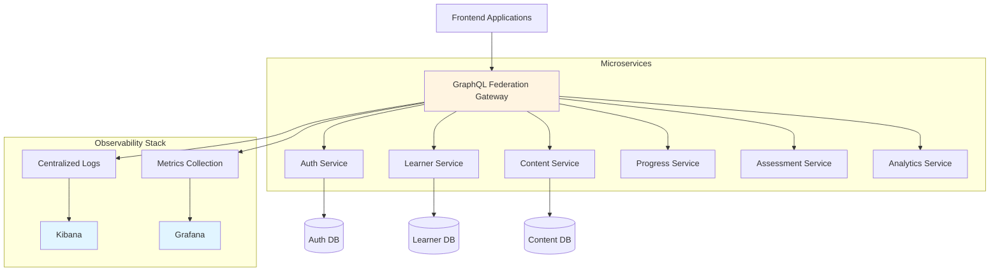

## Overview

At upGrad Education, I built a GraphQL Federation gateway to unify APIs from 20+ microservices. By combining the unified API layer with centralized logging and monitoring via Kibana and Grafana, we reduced production incidents by 60% through faster detection and root-cause analysis.

**Technologies:** GraphQL Federation, Node.js, TypeScript, Kibana, Grafana, Microservices

**Role:** Software Engineer II | **Duration:** Jul 2024 - Feb 2026

## The Problem

The platform had grown organically to 20+ microservices, each exposing its own REST APIs:

- **Scattered APIs:** Frontend teams had to integrate with multiple service endpoints
- **Slow Diagnosis:** When something broke, finding which service caused the issue took significant time
- **No Centralized Visibility:** Logs and metrics were distributed across services
- **Inconsistent Error Handling:** Each service had different error formats and conventions

This architectural fragmentation made it difficult to:
- Debug production issues quickly
- Understand request flows across services
- Implement consistent authentication and error handling
- Monitor system health holistically

## Solution Architecture

### GraphQL Federation Gateway

Built a gateway layer that composed multiple service graphs into a unified API:



### Gateway Implementation

The gateway acted as the single entry point, federating queries across services:

```typescript
// Gateway server setup
import { ApolloGateway, IntrospectAndCompose } from '@apollo/gateway';
import { ApolloServer } from '@apollo/server';

const gateway = new ApolloGateway({
  supergraphSdl: new IntrospectAndCompose({
    subgraphs: [
      { name: 'auth', url: 'http://auth-service/graphql' },
      { name: 'learner', url: 'http://learner-service/graphql' },
      { name: 'content', url: 'http://content-service/graphql' },
      { name: 'progress', url: 'http://progress-service/graphql' },
      // ... 20+ services total
    ],
  }),
});

const server = new ApolloServer({
  gateway,
  plugins: [
    // Request logging and tracing
    loggingPlugin(),
    metricsPlugin(),
  ],
});
```

### Subgraph Schema Example

Each service exposed its domain as a GraphQL subgraph:

```graphql
# Learner service subgraph
extend schema
  @link(url: "https://specs.apollo.dev/federation/v2.0")

type Learner @key(fields: "id") {
  id: ID!
  name: String!
  email: String!
  enrollments: [Enrollment!]!
}

type Enrollment @key(fields: "id") {
  id: ID!
  learnerId: ID!
  courseId: ID!
  enrolledAt: String!
  status: EnrollmentStatus!
}
```

## Observability Implementation

### Centralized Logging with Kibana

All requests through the gateway were logged with structured context:

```typescript
// Logging plugin
function loggingPlugin() {
  return {
    async requestDidStart(requestContext) {
      const requestId = generateRequestId();
      const startTime = Date.now();
      
      return {
        async willSendResponse(responseContext) {
          const duration = Date.now() - startTime;
          
          logger.info('GraphQL Request', {
            requestId,
            operation: requestContext.request.operationName,
            duration,
            success: !responseContext.errors,
            userId: responseContext.contextValue.userId,
            errors: responseContext.errors?.map(e => e.message),
          });
        },
      };
    },
  };
}
```

### Metrics with Grafana

Tracked key operational metrics:

- Request rates per operation
- Error rates per subgraph
- Request duration (p50, p95, p99)
- Active users and session data

```typescript
// Metrics collection
function metricsPlugin() {
  return {
    async requestDidStart(requestContext) {
      metrics.increment('graphql.request.total');
      
      return {
        async willSendResponse(responseContext) {
          const operation = requestContext.request.operationName;
          
          if (responseContext.errors) {
            metrics.increment(`graphql.error.${operation}`);
          } else {
            metrics.increment(`graphql.success.${operation}`);
          }
        },
      };
    },
  };
}
```

## Key Benefits

### 1. Unified API for Clients

**Before:** Frontend made calls to multiple service endpoints:

```typescript
// Multiple API calls
const user = await fetch('/auth-service/user');
const enrollments = await fetch('/learner-service/enrollments');
const progress = await fetch('/progress-service/progress');
```

**After:** Single GraphQL query:

```graphql
query GetLearnerDashboard($userId: ID!) {
  learner(id: $userId) {
    name
    email
    enrollments {
      course {
        title
      }
      progress {
        completionPercentage
      }
    }
  }
}
```

### 2. Faster Incident Response

**Centralized logs in Kibana** allowed filtering by:
- Request ID (trace requests across services)
- Operation name
- Error type
- User ID
- Time range

**Grafana dashboards** showed:
- Which operations were failing
- Which subgraphs had elevated error rates
- Request duration trends

### 3. Consistent Error Handling

Gateway normalized errors from all services:

```typescript
// Error formatting
function formatError(error: GraphQLError) {
  return {
    message: error.message,
    code: error.extensions?.code || 'INTERNAL_SERVER_ERROR',
    path: error.path,
    // Never expose internal stack traces
  };
}
```

## Challenges & Solutions

### Challenge 1: Schema Coordination

**Problem:** 20+ services needed coordinated schema changes.

**Solution:**
- Schema validation in CI/CD prevented breaking changes
- Versioned schemas with deprecation warnings
- Clear communication channels for cross-team schema updates

### Challenge 2: Gateway as Single Point of Failure

**Problem:** If the gateway goes down, all API access is lost.

**Solution:**
- Multiple gateway instances behind a load balancer
- Health checks and automatic failover
- Independent deployment of gateway vs. subgraphs

### Challenge 3: Performance Overhead

**Problem:** Extra hop through gateway could add latency.

**Solution:**
- DataLoader batching to prevent N+1 queries to subgraphs
- Response caching for frequently accessed data
- Monitored p95/p99 latencies to ensure acceptable overhead

## Results

- **60% reduction in production incidents** through faster detection and diagnosis
- **Unified API** simplified frontend integration across 20+ microservices
- **Centralized observability** via Kibana and Grafana enabled rapid root-cause analysis
- **Consistent error handling** improved debugging and user experience

### How We Measured

The 60% reduction came from:
- **Before:** Incident count tracked in previous quarters
- **After:** Lower incident count after gateway + monitoring deployment
- **Attribution:** Both the unified API and centralized logging contributed; we present them together honestly

## Key Learnings

### Federation Architecture
- Many service graphs composed at the gateway (Federation pattern, not BFF)
- Gateway should be thin - business logic stays in subgraphs
- Schema coordination requires process, not just technology

### Observability
- Centralized logging is critical for distributed systems
- Request ID tracing across services enables debugging
- Dashboards are only useful if someone watches them

### What We Didn't Do
- No invented exactly-once delivery claims
- No custom schema registry (used Apollo's built-in composition)
- No claim that the gateway alone caused the 60% reduction (monitoring was equally important)

## Impact

The GraphQL Federation gateway with centralized observability transformed how we:
- **Developed:** Frontend teams integrated with one API instead of 20+
- **Debugged:** Found root causes in minutes instead of hours
- **Monitored:** Single dashboard showed system health across all services
- **Shipped:** Subgraphs could evolve independently with schema validation

This architecture became the foundation for all client-facing APIs at upGrad, proving that thoughtful API design combined with solid observability practices delivers measurable operational improvements.
