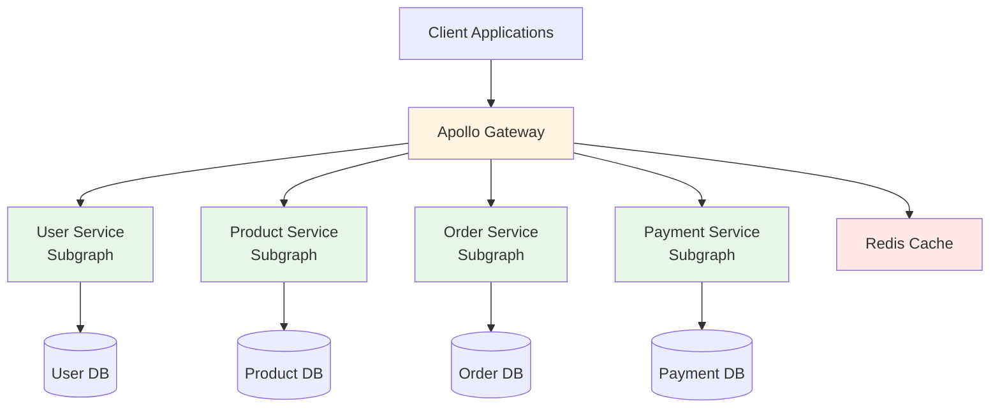
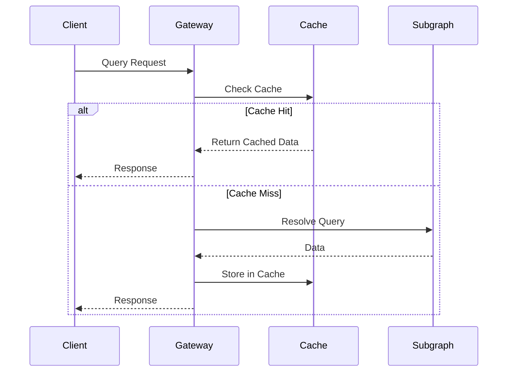

## Overview

TODO: Introduce the project context and why GraphQL Federation was needed.

**Technologies:** GraphQL Federation, Apollo Server, Node.js, TypeScript, NestJS, Redis, Kubernetes

**Role:** Backend Engineer | **Duration:** TODO: Add project duration

## The Problem

TODO: Describe the challenges with the existing API architecture:
- Were there multiple REST APIs that clients had to call?
- What were the pain points for frontend teams?
- Performance issues (over-fetching, under-fetching)?
- How many microservices needed to be unified?

## Federation Architecture

TODO: Replace with your actual federation setup.



## Implementation Details

### Gateway Configuration

TODO: Add code showing how the gateway is configured:

```typescript
// Example gateway setup (replace with actual implementation)
import { ApolloGateway, IntrospectAndCompose } from '@apollo/gateway';
import { ApolloServer } from '@apollo/server';

const gateway = new ApolloGateway({
  supergraphSdl: new IntrospectAndCompose({
    subgraphs: [
      { name: 'users', url: 'http://user-service/graphql' },
      { name: 'products', url: 'http://product-service/graphql' },
      { name: 'orders', url: 'http://order-service/graphql' },
    ],
  }),
});
```

### Subgraph Schema Design

TODO: Show how subgraphs are structured and how entities are shared:

```graphql
# Example entity extension (replace with actual schema)
type User @key(fields: "id") {
  id: ID!
  email: String!
  name: String!
}

extend type Order @key(fields: "id") {
  user: User @requires(fields: "userId")
}
```

### Data Loader Pattern

TODO: Explain how you prevent N+1 queries and optimize data fetching.

## Challenges & Solutions

TODO: Document specific technical challenges:

1. **Challenge:** [e.g., Handling authentication and authorization across subgraphs]
   - **Solution:** [Your approach]

2. **Challenge:** [e.g., Managing schema composition and breaking changes]
   - **Solution:** [Schema validation, versioning strategy]

3. **Challenge:** [e.g., Performance optimization and caching]
   - **Solution:** [Caching strategy, DataLoader usage]

## Caching Strategy

TODO: Describe your caching approach:



## Performance Optimizations

TODO: List optimization techniques implemented:
- Query complexity analysis and limiting
- Persisted queries
- Automatic persisted queries (APQ)
- Response caching strategies
- Field-level caching

## Results & Impact

TODO: Add measurable outcomes:
- ✅ API Latency: \[e.g., "Reduced average query time from Xms to Yms"\]
- ✅ Developer Experience: [e.g., "Frontend teams reduced API integration time by X%"]
- ✅ Reliability: [e.g., "Achieved 99.95% uptime with zero breaking schema changes"]
- ✅ Scalability: [e.g., "Gateway handles X requests/second at pYY latency"]

## Monitoring & Error Handling

TODO: Describe how the federation is monitored:
- Query performance tracking
- Error rates per subgraph
- Schema validation and safety checks
- Apollo Studio integration (if used)

## Testing Strategy

TODO: Explain how federation is tested:
- Contract testing between gateway and subgraphs
- Integration testing approach
- Schema validation in CI/CD
- Load testing results

## Key Learnings

TODO: Add 3-5 important lessons learned:
- Schema design best practices
- Federation-specific gotchas
- Performance considerations
- Team collaboration improvements

## Future Roadmap

TODO: Mention planned improvements:
- [ ] Implement federated tracing
- [ ] Add subscription support
- [ ] Enhance caching with CDN integration
- [ ] Add rate limiting per client
