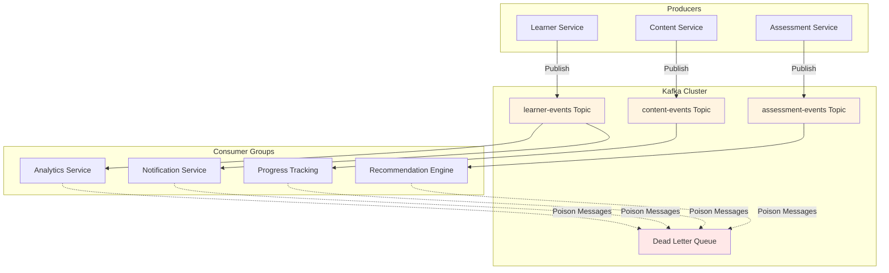

## Overview

At upGrad Education, I owned Kafka producer and consumer patterns across 21+ microservices processing 100K+ events per day. The system handled learner lifecycle and content events, ensuring downstream services remained consistent through traffic spikes and partial outages.

**Technologies:** Apache Kafka, Node.js, TypeScript, Microservices

**Role:** Software Engineer II | **Duration:** Jul 2024 - Feb 2026

## The Challenge

Learner lifecycle and content events needed to reach many downstream services across the platform. The distributed nature of the system created several challenges:

- **Partial Failures:** Failures in one consumer could strand other consumers or leave the system in an inconsistent state
- **Scale:** Processing 100K+ events per day across 21+ microservices required reliable patterns
- **Event Ordering:** A learner's events needed to stay ordered to maintain state consistency
- **Resilience:** Transient failures (network issues, temporary service unavailability) shouldn't block event processing

## Architecture

The event-driven architecture connected multiple domains:



## Implementation

### Producer Pattern

Standard Kafka producer with keying by learner ID to ensure ordered delivery:

```typescript
// Producer publishing learner events
const producer = kafka.producer();

await producer.send({
  topic: 'learner-events',
  messages: [
    {
      key: learnerId.toString(), // Events for same learner go to same partition
      value: JSON.stringify({
        eventType: 'assignment.submitted',
        learnerId,
        assignmentId,
        timestamp: new Date().toISOString(),
        payload: {/* event data */},
      }),
    },
  ],
});
```

**Key Decision:** Partition key = learner ID ensures a learner's events stay ordered on one partition.

### Consumer Pattern with Retries

Each microservice ran as its own consumer group with retry logic for transient failures:

```typescript
// Consumer with retry handling
const consumer = kafka.consumer({ groupId: 'analytics-service' });

await consumer.subscribe({ topic: 'learner-events' });

await consumer.run({
  eachMessage: async ({ topic, partition, message }) => {
    const event = JSON.parse(message.value.toString());

    try {
      await processEvent(event);
    } catch (error) {
      if (isTransientError(error)) {
        // Retry transient failures (network, timeout)
        await retryWithBackoff(event, maxRetries);
      } else {
        // Send to DLQ for poison/repeated failures
        await sendToDeadLetterQueue(event, error);
      }
    }
  },
});
```

### Dead Letter Queue Handling

Poison messages (malformed events, permanent failures) went to a dead-letter topic to prevent blocking the main consumer:

```typescript
async function sendToDeadLetterQueue(event: Event, error: Error) {
  await dlqProducer.send({
    topic: 'learner-events-dlq',
    messages: [
      {
        key: event.learnerId.toString(),
        value: JSON.stringify({
          originalEvent: event,
          error: error.message,
          timestamp: new Date().toISOString(),
        }),
      },
    ],
  });

  // Log for monitoring
  logger.error('Event sent to DLQ', {
    eventType: event.eventType,
    learnerId: event.learnerId,
    error: error.message,
  });
}
```

## Key Design Decisions

### 1. Consumer Groups per Service

Each microservice had its own consumer group, allowing:

- Independent consumption rates
- Service-specific offset management
- Isolated failure domains

### 2. At-Least-Once Semantics

Used at-least-once delivery with idempotent consumers:

- Consumers track processed event IDs to handle duplicates
- Simpler than exactly-once and sufficient for our use case
- No invented complexity for transactions we didn't need

### 3. Retry Strategy

**Transient errors:** Exponential backoff retries (network issues, temporary unavailability)

**Permanent errors:** Immediate DLQ (malformed data, schema mismatches)

This kept the main topic moving even when individual messages failed.

## Challenges & Solutions

### Challenge 1: Consumer Lag During Spikes

**Problem:** Traffic spikes caused consumer lag, delaying downstream processing.

**Solution:**

- Monitored lag metrics per consumer group
- Scaled consumer instances horizontally during known peak windows
- Tuned batch sizes and commit intervals for throughput

### Challenge 2: Event Schema Evolution

**Problem:** Event structure needed to evolve without breaking existing consumers.

**Solution:**

- Versioned event schemas in the payload
- Consumers handled multiple versions gracefully
- Deprecated old versions with monitoring before removal

## Results

- **Reliable processing:** 100K+ events/day across 21+ microservices
- **Consistent downstream state** through traffic spikes and partial outages
- **Graceful degradation:** DLQ prevented poison messages from blocking consumers
- **Ordered processing:** Partition keying maintained event order per learner

## Key Learnings

### Event-Driven Systems

- Clear partition key strategy (learner ID) is critical for ordering
- At-least-once + idempotent consumers is pragmatic; don't claim exactly-once without evidence
- Dead-letter queues are essential for handling poison messages

### Operational Lessons

- Monitor consumer lag per group - it's your early warning system
- Retry transient failures; DLQ permanent ones
- Standard consumer group per service keeps failure domains isolated

### What We Didn't Do

- No custom exactly-once implementation (at-least-once was sufficient)
- No complex saga orchestration (kept event flows simple)
- No invented partition strategies beyond learner ID keying

## Impact

This Kafka infrastructure enabled:

- Multiple teams to build services that consumed learner/content events independently
- Resilient processing that survived individual service failures
- Scalable event distribution without tight coupling between services

The patterns established here became the foundation for all event-driven communication across the upGrad platform, demonstrating that reliable distributed systems come from thoughtful operational patterns, not just technology choices.
