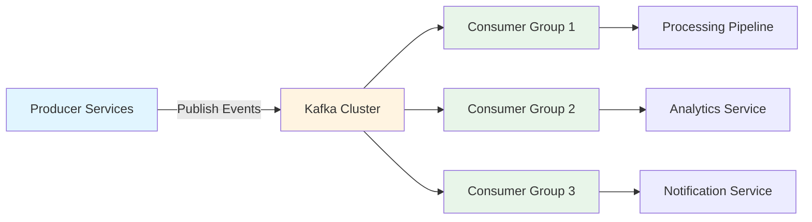
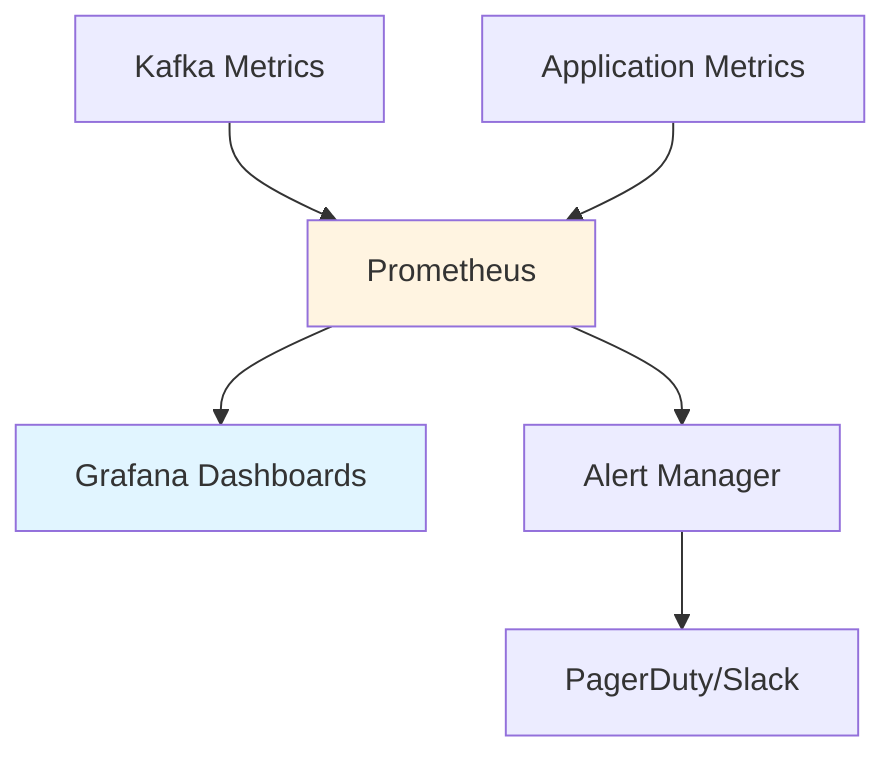

## Overview

TODO: Add a brief introduction to the problem this project solved and why it was important for the business.

**Technologies:** Apache Kafka, Node.js, TypeScript, NestJS, MongoDB, Kubernetes

**Role:** Backend Engineer | **Duration:** TODO: Add project duration

## Challenge

TODO: Describe the specific technical challenge:
- What was the initial state of the system?
- What problems were users/teams experiencing?
- What constraints existed (scale, performance, reliability)?
- Why was Kafka chosen as the solution?

## Solution Architecture

TODO: Replace this placeholder with your actual architecture description.



### Key Design Decisions

TODO: Add 3-5 bullet points about critical architectural decisions:
- Topic partitioning strategy and how you determined the number of partitions
- Consumer group configuration and scaling approach
- Error handling and dead letter queue implementation
- Schema evolution strategy (Avro, JSON Schema, etc.)
- Monitoring and observability setup

## Implementation Highlights

### Event Schema Design

TODO: Add code snippet showing how events are structured:

```typescript
// Example event schema (replace with your actual implementation)
interface OrderCreatedEvent {
  eventId: string;
  eventType: 'order.created';
  timestamp: string;
  version: '1.0';
  payload: {
    orderId: string;
    customerId: string;
    items: Array<{ productId: string; quantity: number }>;
    totalAmount: number;
  };
}
```

### Producer Implementation

TODO: Add relevant code showing producer setup and event publishing logic.

### Consumer Implementation

TODO: Add code showing consumer setup, message processing, and error handling.

## Challenges & Solutions

TODO: Describe 2-3 specific technical challenges encountered and how you solved them:

1. **Challenge:** [e.g., Message ordering guarantee across partitions]
   - **Solution:** [Your approach]

2. **Challenge:** [e.g., Handling backpressure during traffic spikes]
   - **Solution:** [Your approach]

## Results & Impact

TODO: Add quantifiable outcomes:
- ✅ Throughput: \[e.g., "Processed X million events per day with \<Yms latency"\]
- ✅ Reliability: \[e.g., "Achieved 99.9% message delivery guarantee"\]
- ✅ Scalability: \[e.g., "Auto-scaled from X to Y consumers during peak load"\]
- ✅ Business Impact: \[e.g., "Enabled real-time feature X, improving user engagement by Y%"\]

## Monitoring & Observability

TODO: Describe how the system is monitored:
- Metrics tracked (lag, throughput, error rates)
- Alerting strategy
- Tools used (Prometheus, Grafana, DataDog, etc.)



## Key Takeaways

TODO: Add 3-5 lessons learned or best practices discovered during this project.

## Future Enhancements

TODO: Mention potential improvements or features being considered:
- [ ] Implement exactly-once semantics using transactional producers
- [ ] Add schema registry for better schema management
- [ ] Implement KSQL for stream processing
- [ ] Add support for event replay and time-travel debugging
