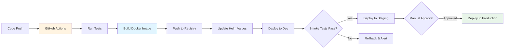
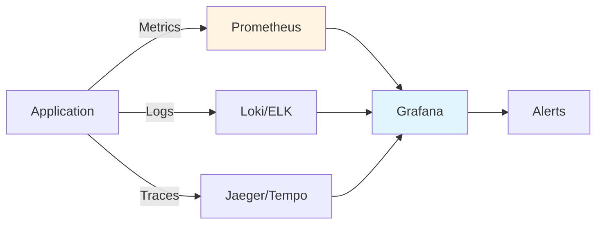

## Overview

TODO: Introduce the deployment challenges and why Kubernetes was adopted.

**Technologies:** Kubernetes, Docker, Helm, GitHub Actions, Terraform, AWS EKS, Prometheus, Grafana

**Role:** Backend Engineer | **Duration:** TODO: Add project duration

## The Challenge

TODO: Describe the pre-Kubernetes deployment process:
- What was the previous deployment method?
- What problems did it have (downtime, slow rollouts, rollback difficulties)?
- How many services needed to be migrated?
- What were the scaling pain points?

## Kubernetes Architecture

TODO: Replace with your actual cluster architecture.

```mermaid
graph TB
    subgraph "AWS EKS Cluster"
        subgraph "Ingress"
            Ingress[Nginx Ingress Controller]
        end
        
        subgraph "Application Tier"
            Deploy1[Service A<br/>Deployment]
            Deploy2[Service B<br/>Deployment]
            Deploy3[Service C<br/>Deployment]
        end
        
        subgraph "Data Tier"
            StatefulSet1[MongoDB<br/>StatefulSet]
            StatefulSet2[Redis<br/>StatefulSet]
        end
        
        subgraph "Monitoring"
            Prometheus[Prometheus]
            Grafana[Grafana]
        end
    end
    
    Users[Users] --> LB[Load Balancer]
    LB --> Ingress
    Ingress --> Deploy1
    Ingress --> Deploy2
    Ingress --> Deploy3
    
    Deploy1 --> StatefulSet1
    Deploy2 --> StatefulSet1
    Deploy3 --> StatefulSet2
    
    Prometheus --> Deploy1
    Prometheus --> Deploy2
    Prometheus --> Deploy3
    Grafana --> Prometheus
    
    style Ingress fill:#e1f5ff
    style Deploy1 fill:#e8f5e9
    style Deploy2 fill:#e8f5e9
    style Deploy3 fill:#e8f5e9
    style Prometheus fill:#fff4e1
```

## Implementation Details

### Deployment Manifests

TODO: Show key Kubernetes resource definitions:

```yaml
# Example Deployment (replace with actual config)
apiVersion: apps/v1
kind: Deployment
metadata:
  name: backend-service
  namespace: production
spec:
  replicas: 3
  strategy:
    type: RollingUpdate
    rollingUpdate:
      maxSurge: 1
      maxUnavailable: 0
  selector:
    matchLabels:
      app: backend-service
  template:
    metadata:
      labels:
        app: backend-service
        version: v1.2.3
    spec:
      containers:
      - name: backend
        image: registry.example.com/backend-service:v1.2.3
        ports:
        - containerPort: 3000
        resources:
          requests:
            memory: "256Mi"
            cpu: "250m"
          limits:
            memory: "512Mi"
            cpu: "500m"
        livenessProbe:
          httpGet:
            path: /health
            port: 3000
          initialDelaySeconds: 30
          periodSeconds: 10
        readinessProbe:
          httpGet:
            path: /ready
            port: 3000
          initialDelaySeconds: 5
          periodSeconds: 5
```

### Helm Charts

TODO: Explain your Helm chart structure and templating approach.

### CI/CD Pipeline

TODO: Describe your deployment pipeline:



TODO: Add GitHub Actions workflow snippet or deployment script.

## Key Features Implemented

### 1. Zero-Downtime Deployments

TODO: Explain rolling update strategy, readiness probes, and PodDisruptionBudgets.

### 2. Auto-Scaling

TODO: Describe HPA (Horizontal Pod Autoscaler) configuration:

```yaml
# Example HPA (replace with actual config)
apiVersion: autoscaling/v2
kind: HorizontalPodAutoscaler
metadata:
  name: backend-service-hpa
spec:
  scaleTargetRef:
    apiVersion: apps/v1
    kind: Deployment
    name: backend-service
  minReplicas: 3
  maxReplicas: 10
  metrics:
  - type: Resource
    resource:
      name: cpu
      target:
        type: Utilization
        averageUtilization: 70
```

### 3. Secrets Management

TODO: Explain how secrets are managed (Sealed Secrets, External Secrets Operator, AWS Secrets Manager integration).

### 4. Health Checks & Monitoring

TODO: Describe liveness/readiness probes, Prometheus metrics, and Grafana dashboards.

## Challenges & Solutions

TODO: Document specific technical challenges:

1. **Challenge:** [e.g., Managing stateful services like databases in Kubernetes]
   - **Solution:** [StatefulSets, persistent volumes, backup strategies]

2. **Challenge:** [e.g., Network policies and service mesh complexity]
   - **Solution:** [Your approach]

3. **Challenge:** [e.g., Resource limits and cost optimization]
   - **Solution:** [Right-sizing, cluster autoscaling, spot instances]

## Disaster Recovery & Backups

TODO: Describe backup strategy:
- Etcd backups
- Persistent volume snapshots
- Database backup procedures
- Disaster recovery runbooks

## Security Practices

TODO: List security measures implemented:
- Network policies
- Pod security policies / Pod security standards
- RBAC configuration
- Image scanning
- Secrets encryption

## Results & Impact

TODO: Add measurable outcomes:
- ✅ Deployment Frequency: [e.g., "Increased from X deploys/week to Y deploys/day"]
- ✅ Deployment Time: \[e.g., "Reduced deployment time from Xmin to Ymin"\]
- ✅ Rollback Time: \[e.g., "Rollback now takes \<2 minutes"\]
- ✅ Uptime: [e.g., "Achieved 99.9% uptime with zero-downtime deployments"]
- ✅ Cost Optimization: [e.g., "Reduced infrastructure costs by X% through auto-scaling"]

## Monitoring & Observability

TODO: Describe monitoring setup:



## Key Takeaways

TODO: Add 3-5 lessons learned:
- Best practices for structuring Kubernetes manifests
- Common pitfalls and how to avoid them
- Resource management insights
- Team onboarding and knowledge sharing

## Future Improvements

TODO: List planned enhancements:
- [ ] Implement GitOps with ArgoCD/Flux
- [ ] Add service mesh (Istio/Linkerd) for advanced traffic management
- [ ] Enhance observability with distributed tracing
- [ ] Implement cost optimization with Kubecost
- [ ] Add multi-cluster support for disaster recovery
