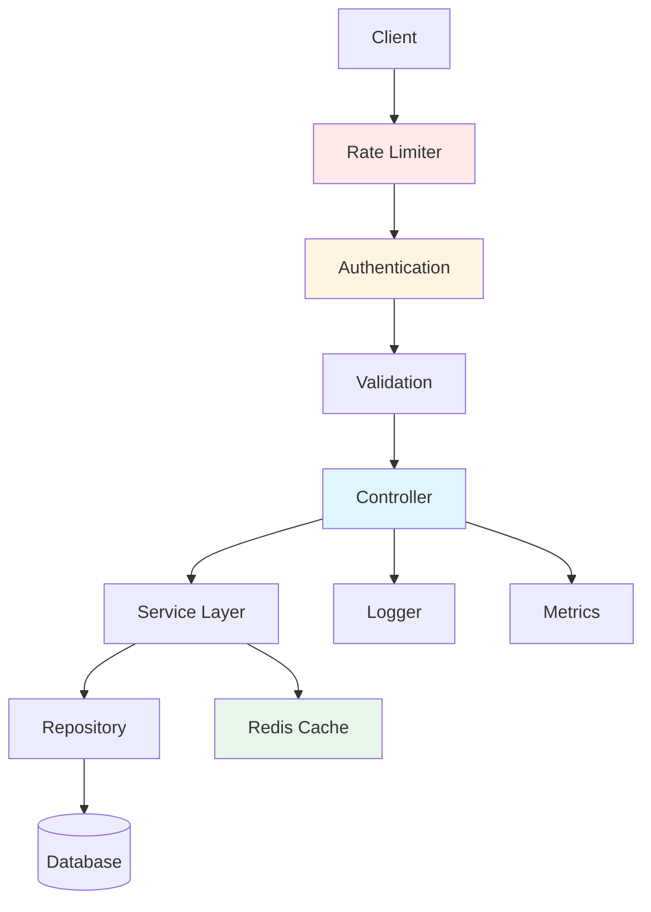

## Overview

TODO: Introduce the API project and its purpose.

**Technologies:** Node.js, TypeScript, NestJS, Redis, MongoDB, Prometheus, Winston

**Role:** Backend Engineer | **Duration:** TODO: Add project duration

## The Challenge

TODO: Describe the initial API state and problems:
- What reliability issues existed?
- Were there performance bottlenecks?
- How were errors being handled?
- What monitoring gaps existed?

## Architecture

TODO: Describe the API architecture:



## Implementation Highlights

### Error Handling

TODO: Show your error handling strategy:

```typescript
// Example custom exception filter (replace with actual implementation)
@Catch()
export class GlobalExceptionFilter implements ExceptionFilter {
  catch(exception: unknown, host: ArgumentsHost) {
    const ctx = host.switchToHttp();
    const response = ctx.getResponse();
    const request = ctx.getRequest();

    const status = exception instanceof HttpException
      ? exception.getStatus()
      : HttpStatus.INTERNAL_SERVER_ERROR;

    const message = exception instanceof HttpException
      ? exception.message
      : 'Internal server error';

    // Log error
    this.logger.error({
      statusCode: status,
      message,
      path: request.url,
      timestamp: new Date().toISOString(),
    });

    response.status(status).json({
      statusCode: status,
      message,
      timestamp: new Date().toISOString(),
      path: request.url,
    });
  }
}
```

### Rate Limiting

TODO: Explain rate limiting implementation.

### Caching Strategy

TODO: Describe caching approach with Redis.

### Observability

TODO: Explain logging, metrics, and tracing setup.

## Results & Impact

TODO: Add measurable outcomes:
- ✅ API Reliability: [e.g., "Reduced 5xx errors by X%"]
- ✅ Response Time: \[e.g., "Improved p95 latency from Xms to Yms"\]
- ✅ Cache Hit Rate: [e.g., "Achieved X% cache hit rate"]

## Key Takeaways

TODO: Add lessons learned.

## Future Enhancements

TODO: List planned improvements.
